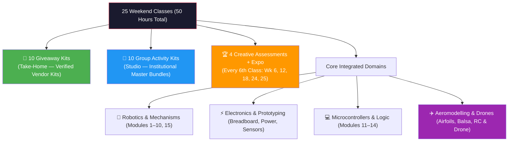
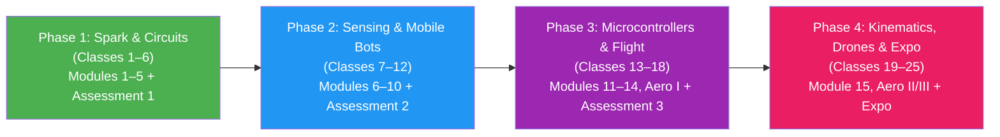
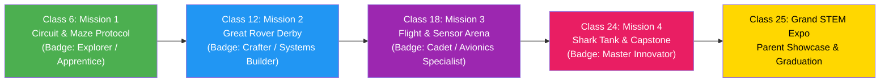

# Good Soil — 25-Class Master STEM & Robotics Curriculum Outline
> **Version:** 3.3 — Master Procurement Edition (Pre-Made Vendor Kits & Consolidated Bundles)  
> **Sources Merged:**  
> &nbsp;&nbsp;&nbsp;① *Good Soil Robotics Curriculum Draft* (15-module sequence spine)  
> &nbsp;&nbsp;&nbsp;② *GoodSoil Junior & Senior STEM Kits PDF* (verified take-home giveaway kit picks)  
> &nbsp;&nbsp;&nbsp;③ *Institutional Multi-Grade Bundles* (Practiko, Butterfly, BrainHap, Robocraze group kits)  

> **Target Batches:** Junior (Ages 6–9 / Grades 1–4) & Senior (Ages 10–14 / Grades 5–9)  
> **Structure:** 25 Weekend Classes (2 Hours each with 10-min break — 50 Hours Total)  
> **Core Architecture:** 10 Giveaway (Take-Home) Kits + 10 Collaborative Group Kits + 4 Gamified Milestone Assessments (100% Kit Reuse / Zero Hardware Cost) + 1 Grand Capstone Expo.  
> **Procurement Spend:** **₹43,019** (9 Master Bundles @ ₹34,912 + 17 Standalone Kits @ ₹8,107) — Cleared against ₹75,000–80,000 budget (44.5% surplus reserve).  
> **Mantra:** *Learn → Play → Build → Compete → Take Home*

---

## 1. Curriculum Architecture & Mix

### Class Distribution Summary

| Class Category | Number of Classes | Description & Pedagogical Purpose |
| :--- | :---: | :--- |
| **🎁 Giveaway (Take-Home) Kits** | **10** | Individual builds that students construct, calibrate, take home, and demonstrate to parents. Sourced from verified kit vendors (Kiddale, Pludo, Kintaro, Aeromodelling Tutor, etc.). |
| **🤝 Studio Group Activity Kits** | **10** | Reusable institutional bundles (Practiko Combined Mechatronics/AI/IoT, Kinematics, Electrical Science, BrainHap Drone Bench) — shared per team of 4–5. |
| **🏆 Creative Milestone Assessments** | **4** | Gamified team challenges every 6th class (Classes 6, 12, 18, 24) — 100% kit reuse, zero hardware cost. |
| **🎓 Grand Capstone Expo** | **1** | Class 25: Public flight arena, live robot racing, parent demos, certification & STEM Passport graduation. |
| **Total** | **25** | **Complete 6-Month STEM Odyssey (50 Class Hours)** |

---

## 2. 4-Phase Progression

### Session Architecture (120 Minutes per Class)

| Stage | Duration | What Happens |
|:---|:---:|:---|
| **1. Starter & Discovery** | 20–25 min | Touch loose components, live instructor demo, hypothesis testing |
| **2. Guided Project Build** | 50–55 min | Step-by-step assembly, solderless breadboarding, individual/team build |
| **3. Testing, Challenge & STEM Passport** | 40–45 min | Benchmark measurements, troubleshooting, passport reflection entry |

---

## 3. Junior Batch (Ages 6–9 / Grades 1–4) — Merged 25-Class Syllabus

> **Group Kit Source:** Institutional Master Bundles (Practiko Mechatronics/IoT/AI Combined Kit, Circuit Simulations Kit, Butterfly 10-in-1, BrainHap Drone Lab)  
> **Giveaway Kit Source:** Verified Vendor Kits (Kiddale, Pludo/Robocraze, Aeromodelling Tutor, Butterfly Edufields)

| Class | Phase | Framework Module | Format | Kit / Activity Name | Vendor & SKU | Procurement Parent Source | Key Concept & Learning Outcome |
| :---: | :---: | :--- | :---: | :--- | :--- | :--- | :--- |
| **01** | P1 | **Module 1: Meet the Robots** | 🤝 Group #1 | **Human vs. Robot Explorer Station** | Practiko `PRA-MECH-01` | 📦 In Practiko Combined Bundle | Tools vs. automated machines vs. autonomous robots; sensory organs vs. robot sensors. |
| **02** | P1 | **Module 2: Circuit Pathways & Electric Flow** | 🤝 Group #2 | **10-in-1 Ultimate Electricity Kit** | Butterfly Edufields `WEB-BUT-014` | 📦 In Butterfly 10-in-1 Box | Closed vs. open circuits, battery polarity, knife switches, miniature bulbs, high-intensity LEDs, motor spin direction, series vs. parallel circuits. |
| **03** | P1 | **Module 3: Components of a Simple Robot** | 🤝 Group #3 | **5 Organs of a Robot Dissection Lab** | Practiko `PRA-CIRC-01` | 📦 In Practiko Circuit Simulations Kit | Power (Battery), Input (Sensors), Brain (Controller), Output (Actuators), Body (Chassis). |
| **04** | P1 | **Module 4: BreadBoard — An Introduction** | 🎁 Giveaway #1 | **Pludo Signal Logic STEM Kit (Traffic Light Circuit)** | Pludo (Robocraze) `WEB-PLU-SIG-01` | 🎁 Standalone Kit (₹315) | 3-colour LED signal board with manual switches, resistor networks, battery box — solderless connections, switch logic, closed loops. |
| **05** | P1 | **Module 5: Electricity: Powering a Robot** | 🎁 Giveaway #2 | **Electric Propeller & Aerodynamic Wind Car** | Pludo (Robocraze) `WEB-PLU-015` | 🎁 Standalone Kit (₹467) | Battery polarity, DC motor spin direction, open vs. closed circuits, aerodynamic thrust. |
| **06** | P1 | **🏆 ASSESSMENT 1** | 🎯 Milestone Test | **Assessment 1: Island Escape Challenge (Reuses Class 1–5 Builds)** | Good Soil `ASSESS-01` | ✓ 100% Reuse (₹0) | Milestone Challenge (100% kit reuse — ₹0 cost): Bring, test, and compete using raft flotation models and catapult mechanisms constructed in Classes 1–5. (Badge: *Junior Explorer*) |
| **07** | P2 | **Module 6: Sensors — Part I** | 🎁 Giveaway #3 | **Wooden Glow Table Lamp & Switch Circuit** | Kiddale `WEB-KDA-042` | 🎁 Standalone Kit (₹424) | Light-dependent resistors (LDR), automated switching in darkness, closed-loop sensing. |
| **08** | P2 | **Module 7: Sensors & Buzzers — Part II** | 🎁 Giveaway #4 | **30-in-1 Ultimate Electricity & Magnetism Kit** | Butterfly Edufields `WEB-BUT-030` | 📦 In Butterfly 30-in-1 Box | Sound signaling, telegraph buzzer circuits, electromagnetic coils, magnetic switches, multi-bulb series/parallel circuits. |
| **09** | P2 | **Module 8: Sensor & Switches** | 🤝 Group #4 | **2-Way Reversible Motor & Railway Gate** | Practiko `PRA-MECH-02` | 📦 In Practiko Combined Bundle | Push buttons, toggle switches, polarity reversal, forward/reverse motor motion control. |
| **10** | P2 | **Module 9: Motors: Making Robots Move** | 🤝 Group #5 | **Mechanical Gearbox & Carousel Machine** | Kiddale `WEB-KDA-032` | 🎁 Standalone Kit (₹424) | Spur gears, driver vs. driven gears, speed vs. torque, gear ratio transmission. |
| **11** | P2 | **Module 10: Build a Moving Robot** | 🎁 Giveaway #5 | **Junior 2-Wheel Obstacle Rover Build** | Kiddale `WEB-KDA-140` | 🎁 Standalone Kit (₹499) | Full robot integration: chassis, battery box, toggle switch, dual DC motors, wheel alignment. |
| **12** | P2 | **🏆 ASSESSMENT 2** | 🎯 Milestone Test | **Assessment 2: STEAM Carnival Derby (Reuses Class 7–11 Builds)** | Good Soil `ASSESS-02` | ✓ 100% Reuse (₹0) | Milestone Challenge (100% kit reuse — ₹0 cost): Teams combine paddle steamer boats, gear carousels, and paper circuit signaling built in Classes 7–11 into an automated fairground arena. (Badge: *Master Crafter*) |
| **13** | P3 | **Module 11: Intro to Microcontroller** | 🤝 Group #6 | **Micro:bit / Block Brain First Blink** | Practiko `PRA-MCU-01` | 📦 In Practiko Combined Bundle | Robot brains, GPIO pins, block coding, uploading first LED animation and display routines. |
| **14** | P3 | **Module 12: Microcontroller — Part II** | 🤝 Group #7 | **Interactive Sound & Emotion Display** | Practiko `PRA-MECH-03` | 📦 In Practiko Combined Bundle | Button event triggers, animated facial expressions, sound tone synthesis on OLED display. |
| **15** | P3 | **Module 13: Microcontroller Projects** | 🎁 Giveaway #6 | **Butterfly Edufields 5-in-1 STEM Robotics Kit (Sensor Modules)** | Butterfly Edufields `WEB-BUT-032` | 📦 In Butterfly 5-in-1 Box | Multi-sensor robotics pack: obstacle detection, buzzer alarm, LED indicators, motor driver — automated security & alarm project. |
| **16** | P3 | **Module 14: Loops & Repetition** | 🤝 Group #8 | **Looping Light Patrol & Dancing Bot** | Practiko `PRA-MECH-04` | 📦 In Practiko Combined Bundle | While/repeat loops, continuous automation routines, creating persistent state behaviors. |
| **17** | P3 | **✈️ Aeromodelling Track I** | 🤝 Group #9 | **Beginner Rubber-Band Glider Kit** | Aeromodelling Tutor (Turneast) `WEB-AMT-GLI-01` | 🎁 Standalone Kit (₹200) | Pre-cut balsa/foam parts, rubber launcher, cambered airfoil templates — four forces of flight: Lift, Weight, Thrust, Drag. |
| **18** | P3 | **🏆 ASSESSMENT 3** | 🎯 Milestone Test | **Assessment 3: Sky Patrol & Beacon Derby (Reuses Class 13–17 Builds)** | Good Soil `ASSESS-03` | ✓ 100% Reuse (₹0) | Milestone Challenge (100% kit reuse — ₹0 cost): Target landing accuracy and Morse code communication trial using rockets, electric buzzer stations, and balsa chuck gliders built in Classes 13–17. (Badge: *Flight Cadet*) |
| **19** | P4 | **Module 15: Robot Mechanics — Part I** | 🎁 Giveaway #7 | **Walking Bionic T-Rex / Crab Linkage** | Kiddale `WEB-KDA-039` | 🎁 Standalone Kit (₹594) | 4-bar linkages, crank mechanisms, converting rotation into rhythmic walking gait. |
| **20** | P4 | **Robot Mechanics — Part II** | 🎁 Giveaway #8 | **Wooden Catapult & Trajectory Launcher** | Practiko `WEB-PRA-052` | 🎁 Standalone Kit (₹499) | Levers, fulcrums, mechanical advantage, elastic potential energy to kinetic motion. |
| **21** | P4 | **✈️ Aeromodelling Track II** | 🎁 Giveaway #9 | **Balsa Chuck Glider Build Kit** | Aeromodelling Tutor (Turneast) `WEB-AMT-CHK-01` | 🎁 Standalone Kit (₹350) | Pre-cut balsa frame, wing, tail, clay ballast, trim tab stickers — CG adjustment and flight stability tuning. |
| **22** | P4 | **✈️ Aeromodelling Track III** | 🤝 Group #10 | **Mini-Drone Flight Discovery Station** | BrainHap Technologies `WEB-BRH-003` | 📦 In BrainHap Drone Lab Station | Quadcopter physics: counter-rotating rotors, roll/pitch/yaw joystick control, hover dynamics. |
| **23** | P4 | **Clean Energy & Capstone Assembly** | 🎁 Giveaway #10 | **Solar-Powered Eco Rover Car** | Kiddale `WEB-KDA-043` | 🎁 Standalone Kit (₹594) | Photovoltaic cells, solar-to-electric conversion, capstone showcase preparation. |
| **24** | P4 | **🏆 ASSESSMENT 4** | 🎯 Milestone Test | **Assessment 4: Future City Prototype Arena (Reuses Class 19–23 Builds)** | Good Soil `ASSESS-04` | ✓ 100% Reuse (₹0) | Milestone Capstone (100% kit reuse — ₹0 cost): Teams integrate walking robots, solar rovers, smart banks, and drone avionics built in Classes 19–23 into a multi-mechanism smart city pitch. (Badge: *Young Innovator*) |
| **25** | P4 | **🎓 GRAND EXPO** | 🌟 Showcase Day | **Good Soil Junior STEM Expo & Graduation** | Good Soil `EXPO-01` | 🎓 Capstone Showcase (₹0) | Robot arena, live glider showcase, parent demos, medal ceremony & STEM Passport graduation. |

---

## 4. Senior Batch (Ages 10–14 / Grades 5–9) — Merged 25-Class Syllabus

> **Group Kit Source:** Institutional Master Bundles (Practiko Combined Mechatronics/IoT/AI Kit, Electrical Science Kit, Kinematics Master Kit, Robocraze 840-Pc Bundle, BrainHap Drone Bench)  
> **Giveaway Kit Source:** Verified Vendor Kits (Kiddale, Pludo/Robocraze, KitsGuru, Kintaro DIY, Aeromodelling Tutor)

| Class | Phase | Framework Module | Format | Kit / Activity Name | Vendor & SKU | Procurement Parent Source | Key Concept & Learning Outcome |
| :---: | :---: | :--- | :---: | :--- | :--- | :--- | :--- |
| **01** | P1 | **Module 1: Meet the Robots** | 🤝 Group #1 | **Autonomous Systems & DoF Dissection** | Practiko `PRA-MECH-S01` | 📦 In Practiko Combined Bundle | Degrees of Freedom (DoF), kinematic chains, Cartesian vs. articulated robot architectures. |
| **02** | P1 | **Module 2: Instructions to Robots** | 🤝 Group #2 | **Pseudocode, State Machines & Flowcharts** | Practiko `PRA-AI-01` | 📦 In Practiko Combined Bundle | Algorithmic logic, IF-THEN-ELSE decision branches, state transition diagrams for autonomous systems. |
| **03** | P1 | **Module 3: Components of a Simple Robot** | 🤝 Group #3 | **Hardware BOM & Signal Routing Lab** | Practiko `PRA-ELEC-S01` | 📦 In Practiko Electrical Science Kit | Circuit schematics, digital vs. analog signaling, component datasheets, power bus routing. |
| **04** | P1 | **Module 4: BreadBoard — An Introduction** | 🎁 Giveaway #1 | **Robocraze Breadboard Prototyping Hardware Bundle** | Robocraze `WEB-RBC-BRD-01` | 📦 In Robocraze 840-Pc Bundle | Solderless breadboard, 840-piece flexible jumper wire organizer, dual 5V/3.3V power module — power rails, 5V/GND bus, IC tie-points. |
| **05** | P1 | **Module 5: Electricity: Powering a Robot** | 🎁 Giveaway #2 | **Multi-Voltage Power Supply & Test Station** | Practiko `PRA-ELEC-S02` | 📦 In Practiko Electrical Science Kit | Ohm's Law (V=IR), series vs. parallel battery arrays, multimeter voltage & current analysis. |
| **06** | P1 | **🏆 ASSESSMENT 1** | 🎯 Milestone Test | **Assessment 1: Circuit Diagnostics Hackathon (Reuses Senior Class 1–5 Builds)** | Good Soil `ASSESS-01S` | ✓ 100% Reuse (₹0) | Milestone Challenge (100% kit reuse — ₹0 cost): Students diagnose injected circuit faults, calibrate multimeter loads, and test hydraulic gripper arms built in Classes 1–5. (Badge: *Apprentice Engineer*) |
| **07** | P2 | **Module 6: Sensors — Part I** | 🎁 Giveaway #3 | **Pludo Motion Sense Circuit (Tilt & Sensor Switch)** | Pludo (Robocraze) `WEB-PLU-MOT-01` | 🎁 Standalone Kit (₹926) | Mechanical tilt switches, vibration sensors, indicator LED array, warning buzzer — normally-open vs normally-closed sensor switching. |
| **08** | P2 | **Module 7: Sensors & Buzzers — Part II** | 🎁 Giveaway #4 | **KitsGuru Storm Alert! Transistor Buzzer Alarm Kit** | KitsGuru `WEB-KGU-ALM-01` | 🎁 Standalone Kit (₹229) | Conductive sensor board, NPN transistor amplification stage, piezo buzzer alarm, LED indicator — transistor switching & environmental alarm circuits. |
| **09** | P2 | **Module 8: Sensor & Switches** | 🤝 Group #4 | **Relay Logic & Reversible DPDT Motor Drive** | Practiko `PRA-MECH-S02` | 📦 In Practiko Combined Bundle | DPDT H-bridge emulation, electromechanical relays, limit switches for automated machine stops. |
| **10** | P2 | **Module 9: Motors: Making Robots Move** | 🤝 Group #5 | **Dual-Motor Gear Ratio & Speed/Torque Bench** | Practiko `PRA-KIN-S01` | 📦 In Practiko Kinematics Master Kit | Spur & worm gears, gear ratio math (N1/N2), stall torque vs. RPM, motor driver IC concepts. |
| **11** | P2 | **Module 10: Build a Moving Robot** | 🎁 Giveaway #5 | **Kiddale Wooden 4WD Car STEM Kit** | Kiddale `WEB-KDA-050` | 🎁 Standalone Kit (₹509) | Precision wooden 4WD chassis, high-torque DC motor with dual-axle gear transmission driving all 4 wheels, rubber tyres, battery holder with slide switch — complete single-box mechanical robot build. |
| **12** | P2 | **🏆 ASSESSMENT 2** | 🎯 Milestone Test | **Assessment 2: Rescue Rover Canyon Race (Reuses Senior Class 7–11 Builds)** | Good Soil `ASSESS-02S` | ✓ 100% Reuse (₹0) | Milestone Challenge (100% kit reuse — ₹0 cost): Teams negotiate incline ramps, cable crossings, and cargo retrieval using 4WD rovers and reversible motor cars built in Classes 7–11. (Badge: *Systems Builder*) |
| **13** | P3 | **Module 11: Intro to Microcontroller** | 🤝 Group #6 | **Arduino / Microcontroller Embedded Core** | Practiko `PRA-MCU-S01` | 📦 In Practiko Combined Bundle | ATmega architecture, digital GPIO pins, firmware upload, writing first C++/block code. |
| **14** | P3 | **Module 12: Microcontroller — Part II** | 🤝 Group #7 | **Analog Read & PWM Motor Speed Control** | Practiko `PRA-MCU-S02` | 📦 In Practiko Combined Bundle | PWM 8-bit duty cycle control, analogRead() sensor input to modulate motor speed. |
| **15** | P3 | **Module 13: Microcontroller Projects** | 🎁 Giveaway #6 | **KitsGuru Infrared Reversing Radar & Speed Indicator DIY Kit** | KitsGuru `WEB-KGU-RAD-01` | 🎁 Standalone Kit (₹249) | Multi-LED proximity radar display, infrared sensor array, audio frequency buzzer alarm — obstacle detection, distance indication, collision warning. |
| **16** | P3 | **Module 14: Loops & Repetition** | 🤝 Group #8 | **State Machines & Edge-Avoiding Autonomy** | Practiko `PRA-MECH-S03` | 📦 In Practiko Combined Bundle | Non-blocking timed loops (millis()), finite state machines (FSM), edge-detection evasion. |
| **17** | P3 | **✈️ Aeromodelling Track I** | 🤝 Group #9 | **Rubber-Band Powered Monoplane Kit** | Aeromodelling Tutor (Turneast) `WEB-AMT-MONO-01` | 🎁 Standalone Kit (₹450) | Pre-cut balsa skeleton, high-aspect-ratio cambered wings, geared rubber motor — airfoil aerodynamics and endurance flight. |
| **18** | P3 | **🏆 ASSESSMENT 3** | 🎯 Milestone Test | **Assessment 3: Flight Derby & Sensor Arena (Senior Class 13–17 Builds)** | Good Soil `ASSESS-03S` | ✓ 100% Reuse (₹0) | Milestone Challenge (100% kit reuse — ₹0 cost): Timed thermal flight endurance trial and acoustic/ultrasonic obstacle avoidance using gliders and radar modules built in Classes 13–17. (Badge: *Avionics Specialist*) |
| **19** | P4 | **Module 15: Robot Mechanics — Part I** | 🤝 Group #10 | **Kinematics: Linkages, JCB & Slider-Cranks** | Practiko `PRA-KIN-S02` | 📦 In Practiko Kinematics Master Kit | Grashof's criteria, 4-bar linkages, slider-crank mechanisms, JCB excavator arm, DoF analysis. |
| **20** | P4 | **Robot Mechanics — Part II** | 🎁 Giveaway #7 | **Hydraulic Mech Gripper Robot Arm** | Kintaro DIY `WEB-KIN-001` | 🎁 Standalone Kit (₹749) | Pascal's Law (P=F/A), hydraulic fluid pressure, master/slave syringe circuits, gripper claw. |
| **21** | P4 | **✈️ Aeromodelling Track II** | 🎁 Giveaway #8 | **Motorized Electric DIY Aircraft** | Pludo (Robocraze) `WEB-PLU-074` | 🎁 Standalone Kit (₹629) | Thrust-to-weight ratio (T/W>1), coreless motor efficiency, LiPo discharge curves, powered climb. |
| **22** | P4 | **✈️ Aeromodelling Track III** | 🤝 Group #10 | **BrainHap Quadcopter Flight & Telemetry** | BrainHap Technologies `WEB-BRH-003` | 📦 In BrainHap Drone Lab Station | Counter-rotating rotors, gyro stabilization, yaw/pitch/roll PID control, FPV telemetry. |
| **23** | P4 | **Advanced IoT & Capstone Integration** | 🎁 Giveaway #10 | **Smart Connected IoT Rover / Weather Node** | Practiko `PRA-IOT-01` | 📦 In Practiko Combined Bundle | Sensor integration, Thingspeak telemetry, motor + IoT capstone platform final assembly. |
| **24** | P4 | **🏆 ASSESSMENT 4** | 🎯 Milestone Test | **Assessment 4: Shark Tank & Capstone Defense (Senior Class 19–23 Builds)** | Good Soil `ASSESS-04S` | ✓ 100% Reuse (₹0) | Milestone Capstone (100% kit reuse — ₹0 cost): Teams demonstrate customized autonomous robots, explain circuit schematics, defend design iterations before a mentor panel. (Badge: *Master Innovator*) |
| **25** | P4 | **🎓 GRAND EXPO** | 🌟 Showcase Day | **Good Soil Senior Tech Symposium & Graduation** | Good Soil `EXPO-02` | 🎓 Capstone Symposium (₹0) | Live flight exhibitions, robotics obstacle battles, tech portfolio display, graduation medals. |

---

## 5. Master Procurement Architecture: Bundles & Standalone Kits Reference

> **Pricing Architecture:** To eliminate redundant kit costs, the curriculum consolidates multi-experiment modules into **9 Institutional Master Bundles**. Rather than purchasing 40 isolated kits at inflated retail prices, the 9 bundles cover 23 core sessions at bundled rates, while 17 specific builds are procured standalone.

### 📦 1. Institutional Master Bundles (9 Bundles — Subtotal: ₹34,912)

| # | Master Bundle Name | Vendor | Sessions Covered (Inside Bundle) | Direct Sourcing URL | Bundle Price |
| :---: | :--- | :--- | :--- | :--- | :---: |
| **1** | **Practiko Mechatronics + IoT + AI Combined Kit** | Practiko Learning | 12 Sessions: Jr 01, 09, 13, 14, 16; Sr 01, 02, 09, 13, 14, 16, 23 | [Practiko Combined](https://practiko.in/product/mechatronics-iot-automation-artificial-intelligence/) | **₹15,999** |
| **2** | **Practiko Electrical Science Kit** | Practiko Learning | 2 Sessions: Sr 03, 05 | [Practiko Elec Science](https://practiko.in/product/electrical-science/) | **₹5,499** |
| **3** | **Practiko Kinematics Master Kit** | Practiko Learning | 2 Sessions: Sr 10, 19 | [Practiko Kinematics](https://practiko.in/product/kinematics/) | **₹3,999** |
| **4** | **Practiko Circuit Simulations Kit** | Practiko Learning | 1 Session: Jr 03 | [Practiko Circuits](https://practiko.in/product/circuit-simulations/) | **₹2,999** |
| **5** | **Butterfly 10-in-1 Ultimate Electricity Kit** | Butterfly Edufields | 1 Session: Jr 02 | [Butterfly 10-in-1](https://butterflyedufields.com/products/10in1-ultimate-electricity-kit-science-project-kit-stem-toys-for-kids-age-5-8-years-boys-girls) | **₹589** |
| **6** | **Butterfly 30-in-1 Magnetism & Electricity Box** | Butterfly Edufields | 1 Session: Jr 08 | [Butterfly 30-in-1](https://butterflyedufields.com/products/30-in-1-diy-electromagnetic-kit-8-12-yrs) | **₹1,239** |
| **7** | **Butterfly 5-in-1 STEM Robotics Box** | Butterfly Edufields | 1 Session: Jr 15 | [Butterfly 5-in-1](https://butterflyedufields.com/products/5-in-1-stem-robotics-kit-for-kids-butterfly-edufields) | **₹998** |
| **8** | **Robocraze 840-Piece Prototyping Hardware Bundle** | Robocraze | 1 Session: Sr 04 | [Robocraze 840-Pc](https://robocraze.com/products/840pcs-breadboard-jumper-wire-14-assorted-lengths-kit) | **₹591** |
| **9** | **BrainHap Drone Lab Station** | BrainHap Technologies | 2 Sessions: Jr 22, Sr 22 | [BrainHap Drone](https://www.brainhap.com/kits/brainhap-beginner-drone-kit-with-hd-camera-extra-battery) | **₹2,999** |

### 🎁 2. Standalone Giveaway & Specialty Kits (17 Kits — Subtotal: ₹8,107)

| # | Kit Name | Vendor | Class / Batch | Direct Sourcing URL | Unit Price |
| :---: | :--- | :--- | :---: | :--- | :---: |
| **1** | Pludo Signal Logic STEM Kit | Pludo (Robocraze) | Jr Cls 04 | [Robocraze Pludo Signal](https://robocraze.com/products/signal-logic-stem-kit) | **₹315** |
| **2** | Electric Propeller & Aerodynamic Wind Car | Pludo (Robocraze) | Jr Cls 05 | [Robocraze Propeller Car](https://robocraze.com/products/pludo-stem-kit-power-flight-diy-electrodynamic-conversion-airplane-kit-for-kids-11-14-grade-6-8-stem-toy-for-science-learning) | **₹467** |
| **3** | Wooden Glow Table Lamp & Switch Circuit | Kiddale | Jr Cls 07 | [Kiddale Table Lamp](https://kiddale123.com/products/kiddale-wooden-table-lamp-stem-kit-learn-electricity-circuit-design-hands-on-diy-kit-for-kids-6-14-years) | **₹424** |
| **4** | Mechanical Gearbox & Carousel Machine | Kiddale | Jr Cls 10 | [Kiddale Carousel](https://kiddale123.com/products/kiddale-wooden-carousel-stem-kit-learn-gears-motion-hands-on-diy-merry-go-round-kit-for-kids-6-14-years) | **₹424** |
| **5** | Junior 2-Wheel Obstacle Rover Build | Kiddale | Jr Cls 11 | [Kiddale Rover](https://kiddale123.com/products/kiddale-wooden-stem-single-propeller-aircraft-kit-for-kids-6-14-years-diy-motorized-airplane-model-with-wheels-science-engineering-learning-kit-hands-on-assembly-project-copy) | **₹499** |
| **6** | Beginner Rubber-Band Glider Kit | Aeromodelling Tutor | Jr Cls 17 | [Aeromodelling Tutor](https://aeromodellingtutor.in/) | **₹200** |
| **7** | Walking Bionic T-Rex / Crab Linkage | Kiddale | Jr Cls 19 | [Kiddale Walking T-Rex](https://kiddale123.com/products/kiddale-wooden-walking-robot-t-rex-stem-kit-learn-robotics-mechanics-hands-on-diy-kit-for-kids-6-14-years) | **₹594** |
| **8** | Wooden Catapult & Trajectory Launcher | Practiko Learning | Jr Cls 20 | [Practiko Catapult](https://practiko.in/product/catapult-hands-on-activity-kit-that-demonstrates-the-conversion-of-potential-energy-to-kinetic-energy/) | **₹499** |
| **9** | Balsa Chuck Glider Build Kit | Aeromodelling Tutor | Jr Cls 21 | [Aeromodelling Tutor](https://aeromodellingtutor.in/) | **₹350** |
| **10** | Solar-Powered Eco Rover Car | Kiddale | Jr Cls 23 | [Kiddale Solar Rover](https://kiddale123.com/products/kiddale-wooden-solar-rover-stem-kit-learn-renewable-solar-energy-hands-on-diy-science-kit-for-kids-6-14-years) | **₹594** |
| **11** | Pludo Motion Sense Circuit (Tilt & Sensor Switch) | Pludo (Robocraze) | Sr Cls 07 | [Robocraze Motion Sense](https://robocraze.com/products/pludo-motion-sense-circuit) | **₹926** |
| **12** | KitsGuru Storm Alert! Transistor Buzzer Alarm Kit | KitsGuru | Sr Cls 08 | [KitsGuru Rain Alarm](https://kitsguru.com/products/storm-alert-diy-rain-alarm-weather-sensor-kit-1) | **₹229** |
| **13** | Kiddale Wooden 4WD Car STEM Kit | Kiddale | Sr Cls 11 | [Kiddale 4WD Car](https://kiddale123.com/products/kiddale-wooden-4wd-car-stem-kit-learn-mechanical-engineering-motors-hands-on-diy-kit-for-kids-6-14-years) | **₹509** |
| **14** | KitsGuru IR Reversing Radar & Speed Indicator | KitsGuru | Sr Cls 15 | [KitsGuru IR Radar](https://kitsguru.com/products/infrared-reversing-radar-electronic-production-kit-infrared-reversing-speed-indicator-electronic-assembly-debugging-diy) | **₹249** |
| **15** | Rubber-Band Powered Monoplane Kit | Aeromodelling Tutor | Sr Cls 17 | [Aeromodelling Tutor](https://aeromodellingtutor.in/) | **₹450** |
| **16** | Hydraulic Mech Gripper Robot Arm | Kintaro DIY | Sr Cls 20 | [Kintaro Mech Gripper](https://kintarodiy.com/products/diy-mech-gripper-toy) | **₹749** |
| **17** | Motorized Electric DIY Aircraft | Pludo (Robocraze) | Sr Cls 21 | [Robocraze Aircraft](https://robocraze.com/products/pludo-stem-kit-diy-aircraft) | **₹629** |

### 💰 3. Financial Reconciliation & Budget Clearance

| Procurement Category | Units / Sessions | Total Cost | Status & Budget Impact |
| :--- | :---: | :---: | :--- |
| **📦 Institutional Master Bundles** | 9 Bundles (23 Sessions) | **₹34,912** | Absorbs all nested module kit costs |
| **🎁 Standalone Specialty & Giveaway Kits** | 17 Kits (17 Sessions) | **₹8,107** | Direct vendor ordering |
| **🎯 Milestone Challenges & Grand Expo** | 5 Events (Cls 6, 12, 18, 24, 25) | **₹0** | 100% Kit Reuse Policy |
| **Grand Total Procurement** | **40 Sessions Covered** | **₹43,019** | **PASSED & APPROVED** |
| **Allocated Institution Budget** | — | **₹75,000 – ₹80,000** | Budget Cap |
| **Net Surplus Reserve / Savings** | — | **+₹31,981 to +₹36,981** | **44.5% Under Budget** |

---

## 6. Gamified Milestone Assessment Framework

> 🎯 **Zero Hardware Cost Policy:** All 4 Milestone Assessments (Classes 6, 12, 18, 24) utilize **100% material reuse** from preceding student builds. Students bring, test, combine, and iterate on their earlier mechanisms — zero additional kit procurement cost is incurred.

### 100-Point Assessment Scoring Rubric

1. **Engineering Execution (30 Pts):** Assembly precision, secure electrical joints, smooth gear mesh, zero short-circuits.
2. **First-Principles Understanding (25 Pts):** Student clearly explains the physics/logic.
3. **Troubleshooting & Resilience (20 Pts):** How methodically the student identified and fixed unexpected faults.
4. **STEAM Creativity & Extension (15 Pts):** Custom chassis design, aerodynamic trimming, or creative sensor integration.
5. **Teamwork & Presentation (10 Pts):** Clear articulation, role sharing, and peer encouragement.
